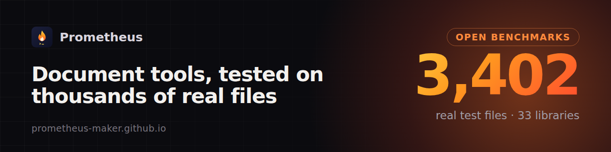

I build small tools, test them on real files, and fix what breaks, including in the open-source libraries I depend on. The [Reader board](https://prometheus-maker.github.io/reader-board/) ranks 33 Python libraries for PDF, Office, OCR and speech on 3,402 real test files and re-tests every new release.

<table>
<tr><td width="50%" valign="top"> <b><a href="https://github.com/prometheus-maker/corpusdiff">corpusdiff</a></b> Did my change break anything on real files? Diff two runs over thousands of test files.</td><td width="50%" valign="top"> <b><a href="https://github.com/prometheus-maker/table-grabber">Table Grabber</a></b> Firefox add-on: any table or list to CSV/Excel, following Next pages.</td></tr>
<tr><td width="50%" valign="top"> <b><a href="https://github.com/prometheus-maker/snapfire">Snapfire</a></b> Firefox add-on: the whole page as one screenshot, no seams.</td><td width="50%" valign="top"> <b><a href="https://github.com/prometheus-maker/photo-location-remover">Photo Location Remover</a></b> See the GPS spot your photo reveals, download a clean copy.</td></tr>
<tr><td width="50%" valign="top"> <b><a href="https://github.com/prometheus-maker/screenshot-renamer">Screenshot Renamer</a></b> Screenshots named after the text in them.</td><td width="50%" valign="top"> <b><a href="https://github.com/prometheus-maker/seat-finder">Wedding seat finder</a></b> One QR code at the door, guests find their table.</td></tr>
</table>

**Open-source work**
- pdfminer.six: [#1314](https://github.com/pdfminer/pdfminer.six/pull/1314) open PDFs where only attachments are encrypted; [#1315](https://github.com/pdfminer/pdfminer.six/pull/1315) fix 0-page PDFs (issue open since 2020)
- trafilatura: [#1092](https://github.com/adbar/trafilatura/pull/1092) thread-safe HTML parsing (crashed ~1 run in 9)
- wappalyzer-next: [#39](https://github.com/s0md3v/wappalyzer-next/pull/39) 5.7× faster scans by skipping CSS selectors that can't match
- Bug reports: [markitdown #2834](https://github.com/microsoft/markitdown/issues/2834), [playwright #43962](https://github.com/microsoft/playwright/issues/43962), [pdfminer.six #493](https://github.com/pdfminer/pdfminer.six/issues/493#issuecomment-6682209581)

**How I work on your project:** I reproduce the bug on a real file first, keep the change small, add a test that fails without it, run your linters and test suite, and follow your contribution policy, including any rule on disclosing how the code was written. If you'd rather not get contributions from me, tell me and I'll stop.

Notes and numbers: [prometheus-maker.github.io](https://prometheus-maker.github.io/) · [About me](https://prometheus-maker.github.io/about.html)
